<!--
  LuKi.exe | Anime Coder profile
  GitHub account: https://github.com/lusieakiquata
  Theme: Midnight Blue + Sakura Pink + Lavender
  Original banner: assets/banner.svg
-->

<div align="center">
  
  <br />
  <a href="https://github.com/lusieakiquata">
    
  </a>
  <p>
    <b>Software Engineering Student</b> · <b>Competitive Programming Enthusiast</b>
  </p>
  <p>
    
    
    
  </p>
</div>

---

### ✦ Player Profile

```cpp
struct LuKi {
    string role = "Software Engineering Student";
    vector<string> interests = {"DSA", "Competitive Programming", "OOP"};
    string currentQuest = "Learn, build, and improve every day";
};
```

- Studying **Information Technology** and working toward **Software Engineering**.
- Practicing **C++**, algorithms, and competitive programming.
- Exploring **object-oriented programming** through personal projects.
- Enjoying **Linux**, creative tools, and the little details behind good software.

> 「One more algorithm, one more adventure.」

### ✦ Skill Inventory

<div align="center">
  
</div>

### ✦ Selected Quests

| Project | Description | Stack |
|:--|:--|:--|
| [**Python-RPG-OOP**](https://github.com/lusieakiquata/Python-RPG-OOP) | A console role-playing game exploring object-oriented design. | `Python` · `OOP` |
| [**LuKi**](https://github.com/lusieakiquata/LuKi) | My NeetCode problem submissions and algorithm practice. | `C++` · `DSA` |

### ✦ Developer Dashboard

<details>
<summary>Show GitHub statistics</summary>
<br />
<div align="center">
  
</div>
</details>

### ✦ Contribution Snake

<!-- Snake appears after .github/workflows/snake.yml successfully runs once. -->
<div align="center">
  <picture>
    <source media="(prefers-color-scheme: dark)" srcset="https://raw.githubusercontent.com/lusieakiquata/lusieakiquata/output/snake-dark.svg" />
    <source media="(prefers-color-scheme: light)" srcset="https://raw.githubusercontent.com/lusieakiquata/lusieakiquata/output/snake-light.svg" />
    
  </picture>
</div>

---

<div align="center">
  <sub>✦ Built with curiosity, C++, and a little bit of sakura magic. ✦</sub>
  <br />
  <sub>Thanks for visiting my little corner of GitHub.</sub>
</div>
